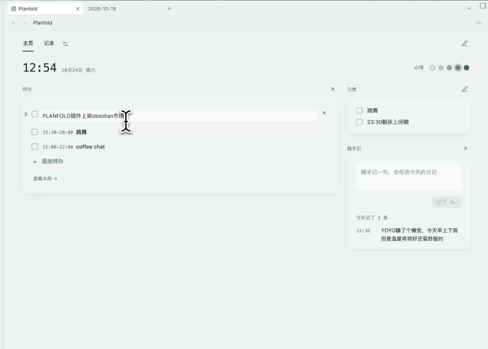
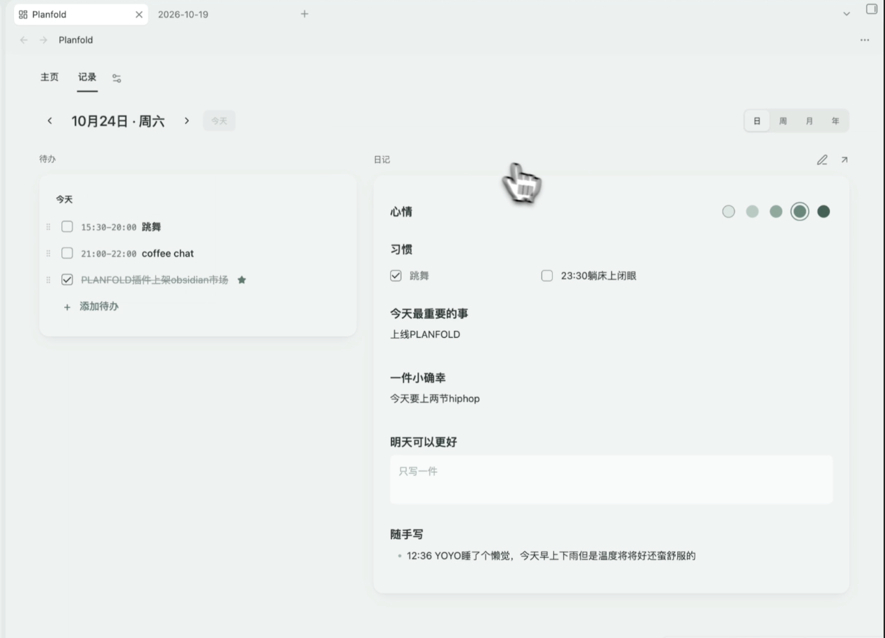
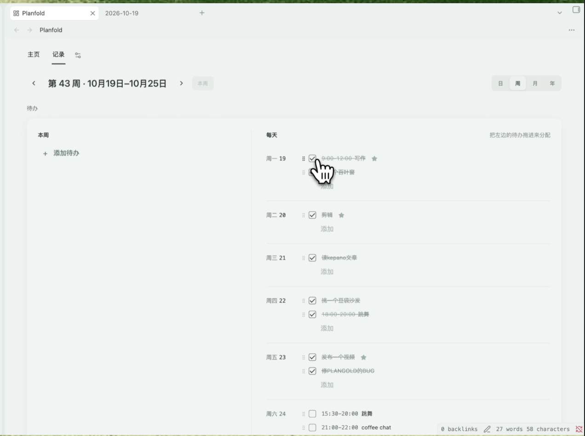

# Planfold

**A planner for Obsidian. Start each day from one home page, plan your weeks, months and years, and look back — all in plain Markdown.**

English | [中文](README.zh-CN.md)

> [!NOTE]
> - **Payment:** Home and daily notes are free. Weekly, monthly and yearly plans, Review and the calendar view need **Planfold Pro** (one-time purchase).
> - **Network:** Planfold only goes online if you activate a Gumroad key (checked once) or leave your email for update notes (Buttondown). Your notes are never sent anywhere.

## Highlights

- **Home** — today's to-dos, mood, habits and quick notes in one place.
- **Note** — a day, week, month or year: its to-dos on the left, its note on the right.
- **Review** *(Pro)* — your month or year on one page: days written, mood, habits, best week.
- **Calendar** *(Pro)* — timed to-dos laid out by the hour in the sidebar.
- **Plain Markdown** — everything lives in your own daily, weekly and monthly notes. Works with Obsidian Daily notes and Periodic Notes.
- **English and Chinese.**

## Free vs Pro

| Features | Free | Pro |
|---|:-:|:-:|
| Home: to-dos, mood, habits, quick notes | ✅ | ✅ |
| Daily notes | ✅ | ✅ |
| Weekly, monthly and yearly plans and reviews | ❌ | ✅ |
| Review | ❌ | ✅ |
| Calendar view | ❌ | ✅ |

**Get Pro:** Gumroad (international) or the Xiaohongshu shop (China). Pay once, use it on all your devices.
**Activate:** open any Pro page, paste your key, press **Activate**.

## Install

**Settings → Community plugins → Browse**, search “Planfold”, install and enable. A short setup walks you through the rest.

## Contact

remi.rx@hotmail.com

All rights reserved. See [LICENSE](LICENSE).
