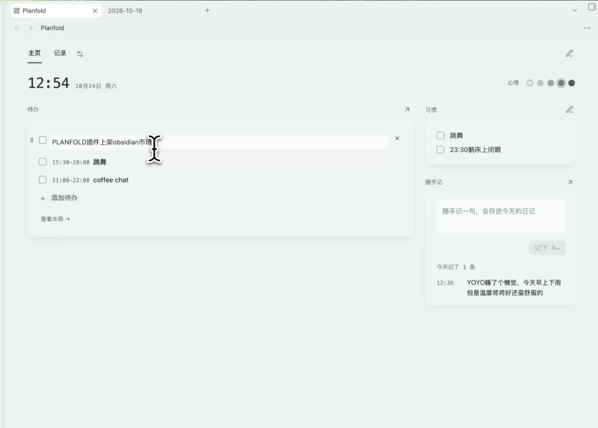
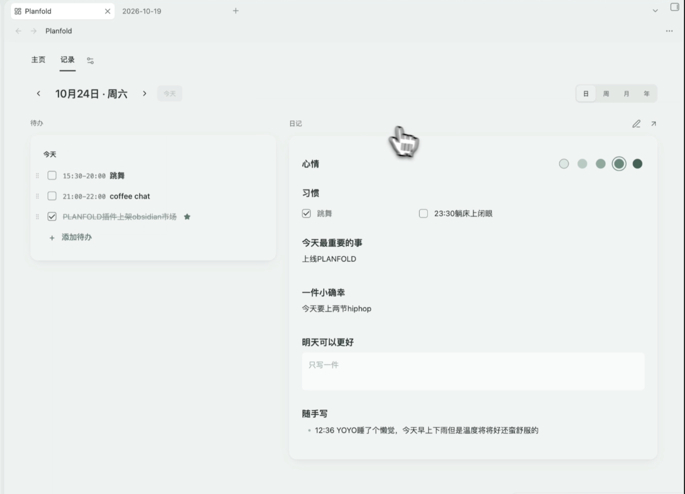
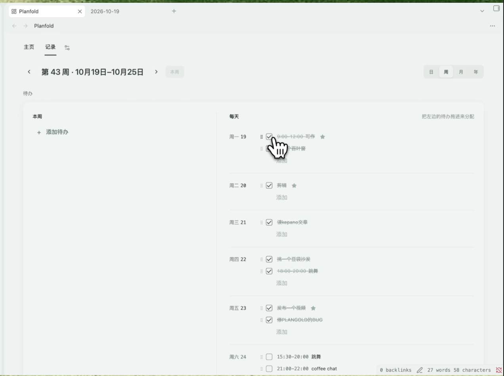

# Planfold

**Obsidian 里的计划本：每天从一个主页开始，按周、月、年规划和回顾。所有内容都是普通的 Markdown。**

[English](README.md) | 中文

> [!NOTE]
> - **付费**：主页和每日记录免费；周、月、年的计划，回顾，日历视图需要 **Planfold Pro**（一次买断）。
> - **联网**：只在两种情况下联网：激活 Gumroad 激活码时（验证一次），以及你留下邮箱订阅更新时（Buttondown）。你的笔记不会被发送到任何地方。

## 亮点

- **主页**：今天的待办、心情、习惯、随手记，都在一处。
- **记录**：按日、周、月、年切换，左边待办，右边笔记。
- **回顾** *（Pro）*：一个月、一年一页看完：记了几天、心情、习惯、最好的一周。
- **日历** *（Pro）*：右侧栏按小时排好带时间的待办。
- **纯 Markdown**：内容都在你自己的日记、周记、月记里，兼容 Obsidian 日记和 Periodic Notes。
- **中文和英文界面。**

## Free 与 Pro

| 功能 | Free | Pro |
|---|:-:|:-:|
| 主页：待办、心情、习惯、随手记 | ✅ | ✅ |
| 每日记录 | ✅ | ✅ |
| 周、月、年的计划和复盘 | ❌ | ✅ |
| 回顾 | ❌ | ✅ |
| 日历视图 | ❌ | ✅ |

**购买**：国内小红书店铺，海外 Gumroad。一次买断，自己的多台设备都能用。
**激活**：打开任意一个 Pro 页面，粘贴激活码，点「激活」。

## 安装

**设置 → 第三方插件 → 浏览**，搜索「Planfold」，安装并开启。第一次打开会有简短的引导。

## 联系

remi.rx@hotmail.com

保留所有权利，见 [LICENSE](LICENSE)。
